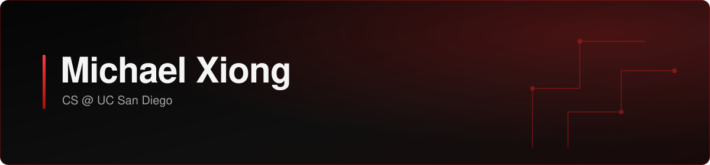
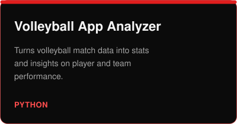
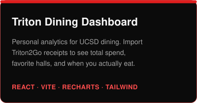
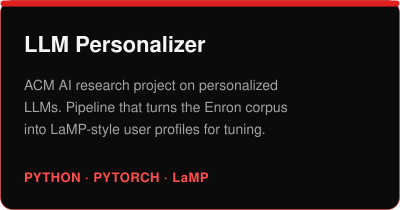

### Hi, I'm Michael Xiong

Computer Science student at **UC San Diego** focused on **applied AI** and **software engineering**. I like building end-to-end systems, from data pipelines and ML models to the dashboards and apps people actually use. Lately I've been working on LLM personalization, reinforcement fine-tuning, and sports and campus analytics.

Currently: Working on a Volleyball Video Analysis App

### Projects

  
  <!-- TODO: replace the link above with the Volleyball App Analyzer repo URL -->
  
  

### Experience

<!--
  Add internships below, newest first. Copy this block for each one:

  **Role Title** · Company Name
  Month YYYY – Month YYYY · City, ST
  - What you built or owned, and the result
  - Tools / stack used
-->

**Wind Farm Agentic AI Research Intern** · Center for Mathematical AI, Chinese University of Hong Kong 
March 2026 – September 2026 · Hybrid, Hong Kong
- Trained and evaluated reinforcement learning policies on a wind farm simulation envrionment.

### Tech

